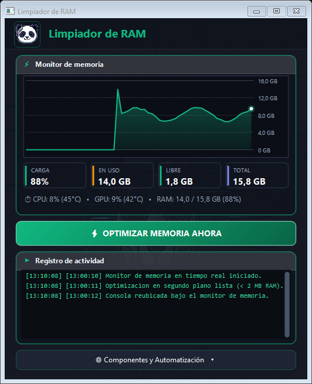

# 🐼 Limpiador de RAM v1.0.0

Aplicación nativa de Windows (C# .NET) de alto rendimiento diseñada bajo **Windows 11 Fluent Design / Dark Mode**, especializada en la monitorización en tiempo real y optimización profunda de memoria RAM con telemetría de hardware, funcionamiento ultra-eficiente en segundo plano (< 2 MB de RAM) e instalador autónomo integrado.



---

## 🌟 Características Principales

### 1. 📊 Monitor de Memoria estilo Administrador de Tareas
- **Gráfica continua en tiempo real**: Curvas de spline dinámicas con efecto montañitas y degradado translúcido.
- **Escala métrica calibrada en GB**: Eje vertical calibrado en tiempo real según la memoria física total instalada (ej. `16,0 GB`, `12,0 GB`, `8,0 GB`, `4,0 GB`, `0 GB`).
- **Métricas instantáneas**: Chips visuales de **Carga (%)**, **En Uso (GB)**, **Libre (GB)** y **Total (GB)**.
- **Telemetría de Hardware**:
  - `⏱ CPU`: Carga en % y temperatura estimada (°C) mediante `GetSystemTimes`.
  - `GPU`: Porcentaje de uso y temperatura de aceleración gráfica.
  - `RAM`: Uso detallado y porcentaje de saturación.

### 2. ⚡ Modo Segundo Plano Ultra Eficiente (< 2 MB de RAM y 0% CPU)
- **Vaciado de memoria física (`EmptyWorkingSet` & `SetProcessWorkingSetSize`)**:
  Al minimizar la aplicación a la bandeja del sistema (*System Tray* junto al reloj), purga sus páginas inactivas de la memoria física de Windows, reduciendo su consumo en el Administrador de Tareas a solo **1.5 ~ 2.5 MB de RAM**.
- **Suspensión inteligente de renderizado**:
  Mientras la ventana está oculta, se detiene el dibujo de gráficos GDI+ y el muestreo de CPU/GPU, reduciendo el consumo a **0.00% de CPU**.

### 3. 🧹 Componentes de Optimización Profunda (Win32 API)
- **Memoria de aplicaciones en segundo plano**: Llamada a `EmptyWorkingSet` (`psapi.dll`) en todos los procesos no protegidos para liberar memoria no utilizada.
- **Archivos temporales del sistema y cachés**: Limpieza de `%TEMP%`, `%WINDIR%\Temp`, `%WINDIR%\Prefetch` y cachés protegidos.
- **Papelera de reciclaje**: Vaciado silencioso sin confirmaciones mediante `SHEmptyRecycleBin` (`shell32.dll`).
- **Purgar caché DNS**: Restablecimiento inmediato mediante `DnsFlushResolverCache` (`dnsapi.dll`).
- **Recolección forzada de basura**: Compactación de montículo y liberación de finalizadores.

### 4. ⚙️ Automatización Inteligente & Persistencia Total
- **Auto-limpieza al superar umbral**: Optimización automática al superar el porcentaje configurado (ej. 85% o 95%).
- **Auto-limpieza periódica**: Intervalo configurable cada X minutos (ej. cada 30 min).
- **Inicio automático con Windows (3 Niveles)**:
  - **Programador de Tareas (`schtasks`)**: Inicio al iniciar sesión con máximos privilegios (`/rl HIGHEST`), permitiendo arrancar con permisos de Administrador **sin bloquearse ni pedir confirmación UAC**.
  - **Carpeta de Inicio (`Startup`)**: Acceso directo con modificador `/tray`.
  - **Clave `Run` del Registro (`HKCU`)**: Como respaldo secundario.
- **Persistencia garantizada**: Recuerda el estado de todos los interruptores y si la barra de ajustes estaba desplegada o plegada.

### 5. 📦 Instalador Autónomo ([Setup_LimpiadorRAM.exe](Setup_LimpiadorRAM.exe))
- Instalador nativo de archivo único (846 KB) con tema oscuro y Cyber Panda.
- Extrae la aplicación y recursos en `%LocalAppData%\Programs\LimpiadorRAM`.
- Crea accesos directos en el Escritorio y Menú Inicio.
- Se registra en *Configuración > Aplicaciones instaladas* de Windows e incluye desinstalador limpio.
- Incluye script de [Inno Setup](installer.iss) para máxima compatibilidad.

---

## 📁 Estructura del Repositorio

```
Limpiador-de-ram/
├── LimpiadorRAM.exe        # Ejecutable principal compilado (171 KB)
├── Setup_LimpiadorRAM.exe  # Instalador autónomo compilado (869 KB)
├── app.ico                 # Icono Windows multi-resolución (16x16 a 256x256)
├── compilar.bat            # Compilador de la aplicación principal
├── compilar_setup.bat      # Compilador del instalador autónomo
├── ejecutar.bat            # Acceso rápido de ejecución
├── installer.iss           # Script de instalación para Inno Setup
├── README.md               # Documentación del proyecto
├── .gitignore              # Filtro de archivos para Git
├── resources/              # Recursos visuales y activos
│   ├── app.ico             # Icono principal
│   ├── panda_clean.png     # Avatar pixel art del Cyber Panda
│   ├── watermark_bg.jpg    # Fondo panorámico con circuitos y marca de agua
│   ├── ui_compact_collapsed.png
│   └── ui_compact_expanded.png
└── src/                    # Código fuente en C#
    ├── AssemblyInfo.cs     # Metadatos del ensamblado
    ├── Controls.cs         # Controles personalizados Fluent (Gráfica, Cards, Toggles, Chips, Scrollbar)
    ├── MainForm.cs         # Interfaz gráfica principal y ciclo de eventos
    ├── MemoryManager.cs    # Lógica de optimización y llamadas a Win32 API
    ├── Program.cs          # Punto de entrada, mutex de instancia única y elevación UAC
    ├── Settings.cs         # Persistencia XML y configuración de arranque
    ├── TrayAppContext.cs   # Gestor de bandeja del sistema y menús contextuales
    ├── app.manifest        # Manifiesto UAC requireAdministrator
    └── Installer/          # Código fuente del instalador
        └── SetupProgram.cs # Interfaz y motor de instalación
```

---

## 🛠️ Compilación desde el Código Fuente

El proyecto no requiere dependencias externas ni Node.js. Utiliza exclusivamente el compilador nativo de Windows:

```cmd
# Compilar la aplicación principal
compilar.bat

# Compilar el instalador autónomo
compilar_setup.bat
```

---

## 📄 Licencia

Desarrollado bajo licencia MIT. Libre para uso personal y modificaciones.
